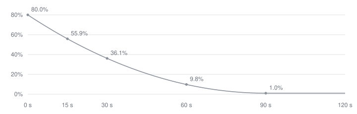
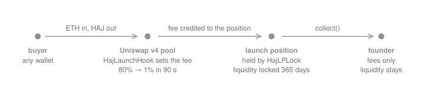

<p align="center"></p>

<p align="center"><b>haj</b> · <b>$HAJ</b> · a fixed-supply utility token for <a href="https://www.haj.trading">haj</a> · Base</p>

**Live on Base** · minted Nov 23, 2026, every transaction signed on a Ledger · all contracts verified on Basescan

```
$HAJ   0x1F6dCE8488Db35650480b210D6C5498bEeAa4bee
pool   Uniswap v4, ETH/$HAJ · opened at a $10,000 starting value with a $100 ETH floor
lock   0x6B0DfB5cebDB1D56fE261F41e854ba48a31a10e8 · both pool positions locked until Nov 23, 2027
```

[Basescan](https://basescan.org/token/0x1F6dCE8488Db35650480b210D6C5498bEeAa4bee) ·
[Uniswap](https://app.uniswap.org/explore/tokens/base/0x1F6dCE8488Db35650480b210D6C5498bEeAa4bee) ·
[DexScreener](https://dexscreener.com/base/0x1F6dCE8488Db35650480b210D6C5498bEeAa4bee) ·
[the lock](https://basescan.org/address/0x6B0DfB5cebDB1D56fE261F41e854ba48a31a10e8) ·
[all addresses](deployments/base.json)

**Supply**

```
1,000,000 HAJ   minted once, never again

  600,000  60%  HAJ/ETH pool, Uniswap v4 on Base  · for sale from the starting price up · locked 12 months
  200,000  20%  later seasons                     · locked 12 months
  100,000  10%  Season 1, first 1,000 users       · claims open Dec 18, 2026
  100,000  10%  founder                           · nothing for 12 months, then linear over 12
```

**Token** · [`src/HajToken.sol`](src/HajToken.sol)

```solidity
contract HajToken is ERC20 {
    uint256 public constant SUPPLY = 1_000_000e18;

    constructor() ERC20("haj", "HAJ") {
        _mint(msg.sender, SUPPLY); // the only mint, ever
    }
}   // no owner · no mint() · no pause() · no upgrade
```

**Locks** · [`script/Deploy.s.sol`](script/Deploy.s.sol) · [`src/HajLPLock.sol`](src/HajLPLock.sol)

```solidity
// OpenZeppelin VestingWallet, unmodified
new VestingWallet(founder, launch + 365 days, 365 days); // nothing for a year after mint
new VestingWallet(seasons, launch + 365 days, 0);        // released a year after mint

// HajLPLock: every pool position, the launch one and each later top-up, 365 days from its deposit
function withdraw(uint256 tokenId, address to) external onlyOwner {
    if (block.timestamp < unlockAt[tokenId]) revert Locked(unlockAt[tokenId]);
    IERC721(address(positions)).safeTransferFrom(address(this), to, tokenId);
}
function collect(uint256 tokenId) external onlyOwner {  // trading fees to the owner, liquidity stays
    actions   = [DECREASE_LIQUIDITY, TAKE_PAIR];
    params[0] = abi.encode(tokenId, 0, 0, 0, "");        // decrease by zero: how v4 pays out fees
    params[1] = abi.encode(currency0, currency1, owner);
    positions.modifyLiquidities(abi.encode(actions, params), block.timestamp);
}
// never removes liquidity · never approves anyone · never sets a subscriber: nothing else can move a position
```

**Sniper protection** · [`src/HajLaunchHook.sol`](src/HajLaunchHook.sol) · [`script/Pool.s.sol`](script/Pool.s.sol)

<p align="center"></p>

```
fee(t) = 1% + 79% × ((90 − t) / 90)²     the first 90 seconds after the pool's liquidity lands, then 1% forever

   0 s  80.0%     15 s  55.9%     30 s  36.1%     60 s  9.8%     90 s  1.0%     120 s  1.0%
```

The pool's LP fee starts at 80% and falls to 1%, so a bot buying in the launch block keeps a fifth of what it
puts in (on a fork of Base, $100 at second 0 buys 2,002 HAJ; at second 120 it buys 9,785). Pool, positions and lock
happen in one Ledger broadcast, and the clock starts when the liquidity lands. Only the founder can open the pool,
nobody can trade or add liquidity before that, and only the founder can add liquidity during the 90 seconds. The
hook has no owner, no admin and no setters.

**Fees paid during the first 90 seconds go to the locked launch positions, which pay out to the founder.**

**The pool** · [`script/Pool.s.sol`](script/Pool.s.sol)

```
sale     600,000 HAJ, single-sided, from the starting price up      buys move the price; no ETH needed to open
floor    ETH only, from 95% down to 50% of the starting price        HAJ sold below the start meets real ETH
both     minted straight into the lock, 12 months, fees to the founder
```

The starting value (all 1,000,000 HAJ at the opening price) is a number set at launch, not ETH in the pool: buyers
put the ETH in. At a $10,000 start, $100 buys about 1% of the supply and moves the price about 3.4%.

**On a real chain** · two Base Sepolia rehearsals, every transaction signed on a Ledger

<p align="center"></p>

The launch, exactly as it runs at mint (the sale and the floor):

```
deploy     9 signatures   token, both vaults, claims, lock, hook · 600,000 HAJ left with the founder for the pool
pool       9 signatures   open, mint the sale (#34301) and the floor (#34302) into the lock, register both
after      founder holds 0 HAJ · both positions locked until Nov 23, 2027 · launch fee 80% → 1% in 90 s, read on chain
```

[the pool's liquidity](https://sepolia.basescan.org/tx/0x8765c4fae7f2afbdf5363f8810626ed79470fa69ca7e1782cb66c6a8cbc21b13) ·
[the lock](https://sepolia.basescan.org/address/0x2E3DF02fb68Ab66F29e0eDC70461007734986779) ·
[addresses](deployments/base-sepolia.json)

Fees, proven on the first rehearsal:

```
buy        0.0002 ETH → 69,964.66 HAJ, through Uniswap's test router      1% fee credited to the locked position
collect()  0.000002 ETH to the founder, exactly that 1%                   liquidity unchanged · position still locked
withdraw() Locked(Nov 21, 2027)
```

[buy](https://sepolia.basescan.org/tx/0x981d63f4a1cfe7493f9fb6b90bd3526f9e6992e8f2b69f0d6d5aefeab349cced) ·
[collect](https://sepolia.basescan.org/tx/0x3516d5915436efcbbdaff09e65d42babbe3630193ee6ae2d469a90ab78be0531) ·
[the lock](https://sepolia.basescan.org/address/0x26Dd245714cFE1D2f2E651EE39909311567F60e8) ·
[addresses](deployments/base-sepolia-v1.json)

**Claims** · [`src/HajClaim.sol`](src/HajClaim.sol)

```solidity
function setRoot(bytes32 root_) external {
    if (msg.sender != rootSetter) revert NotRootSetter();
    if (root != bytes32(0)) revert RootAlreadySet();    // once, at the end of Season 1
    root = root_;
    opensAt = uint64(block.timestamp);
}
// claimed HAJ unlocks evenly over 90 days from opensAt
// unclaimed after 180 days → sweep() to the seasons lock, never the founder
```

**Earning, Season 1**

```
bar        5 paper trades + 7 active days    (an active day = a trade that UTC day)
sign-up    15 HAJ                            (counts once the bar is cleared)
usage      20 HAJ
week two   15 HAJ                            (14 active days)
ranks      share of 50,000 HAJ
           first 1,000 accounts to clear the bar
```

**Run it**

```sh
forge test                      # unit tests + a full launch on forks of Base and Base Sepolia

# launch, every transaction signed on a Ledger (Deploy also deploys the hook; Pool opens the pool, fills it, locks it)
# START_ETH: what all 1,000,000 HAJ are worth at open · FLOOR_ETH: the ETH floor under the starting price
FOUNDER=0x… SEASONS=0x… forge script script/Deploy.s.sol --rpc-url base --ledger --sender $FOUNDER --broadcast --verify
FOUNDER=0x… START_ETH=<wei> FLOOR_ETH=<wei> forge script script/Pool.s.sol --rpc-url base --ledger --sender $FOUNDER --broadcast
```

Logo and listing pack: [`assets/token/`](assets/token/LISTING.md).

Can't: mint more · pause transfers · pull liquidity · founder sells in the first year. No presale, no insider allocations.

<sub>A utility token for use within haj; nothing here is an offer to sell or investment advice. MIT.</sub>
