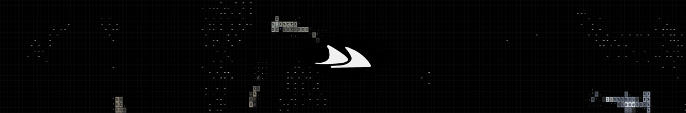

<p align="center"></p>

<p align="center"><b>$HAJ</b> · a fixed-supply utility token for <a href="https://www.haj.trading">haj</a> · Base · contracts Nov 18 · mint Nov 20, 2026</p>

**Supply**

```
1,000,000 HAJ   minted once, never again

  600,000  60%  HAJ/WETH pool, Uniswap v3 on Base · position locked 12 months
  200,000  20%  later seasons                     · locked 12 months
  100,000  10%  Season 1, first 1,000 users       · claims open Dec 18, 2026
  100,000  10%  founder                           · nothing for 12 months, then linear over 12
```

**Token**

```solidity
contract HajToken is ERC20 {
    constructor() ERC20("haj", "HAJ") {
        _mint(msg.sender, 1_000_000e18); // the only mint, ever
    }
    // no owner · no mint() · no pause() · no upgrade
}
```

**Locks**

```solidity
// OpenZeppelin VestingWallet, unmodified
new VestingWallet(founder, launch + 365 days, 365 days); // nothing before Nov 20, 2027
new VestingWallet(seasons, launch + 365 days, 0);        // released Nov 20, 2027

// HajLPLock: every pool position, the launch one and each later top-up
function withdraw(uint256 id) external onlyOwner {
    require(block.timestamp >= unlockAt[id], "locked"); // 365 days from its deposit
}
function collect(uint256 id) external onlyOwner;        // trading fees only, liquidity stays
```

**Claims**

```solidity
function setRoot(bytes32 root_) external onlyOwner {
    require(root == bytes32(0), "set once");            // at the end of Season 1
    root = root_;
}
// claimed HAJ unlocks evenly over 90 days
// unclaimed after 180 days → the seasons lock, never the founder
```

**Earning, Season 1**

```
bar        5 paper trades + 7 active days    (an active day = a trade that UTC day)
sign-up    15 HAJ                            (counts once the bar is cleared)
usage      20 HAJ
week two   15 HAJ                            (14 active days)
ranks      share of 50,000 HAJ
           first 1,000 accounts to clear the bar
```

Can't: mint more · pause transfers · pull liquidity · founder sells before Nov 2027. No presale, no insider allocations.

<sub>A utility token for use within haj; nothing here is an offer to sell or investment advice. MIT.</sub>
